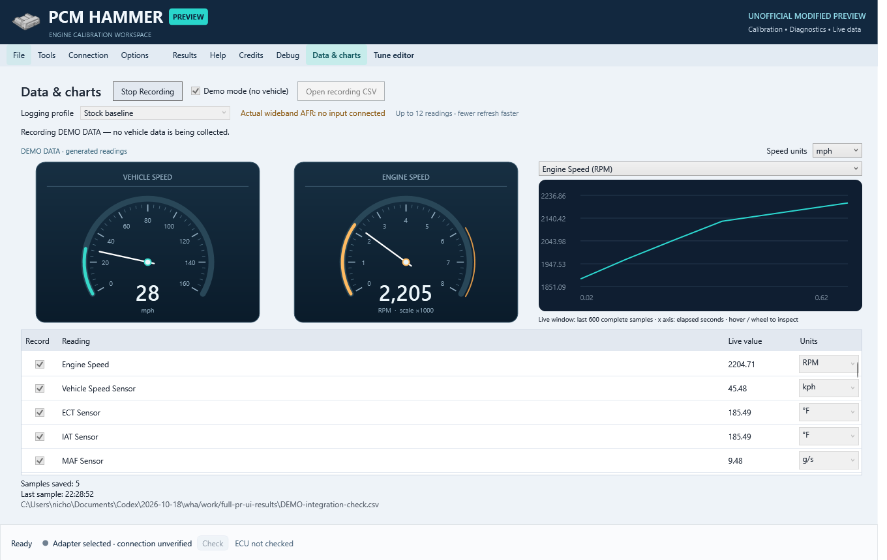
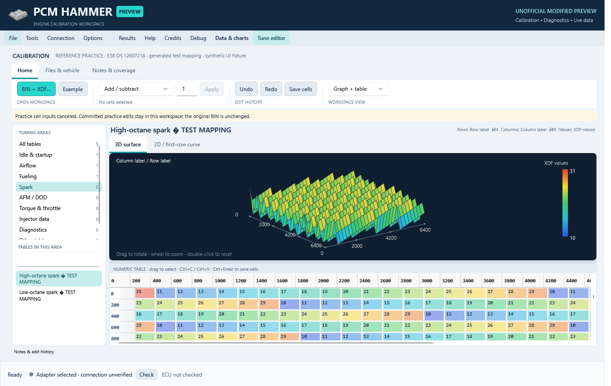

# Integrated workspace validation

October 18, 2026. Windows x64 host, .NET SDK 10.0.402. WPF UI target: Windows x86. Tests below were run against the complete proposed host-overhaul branch based on `ac45d15958cfd8591bf0c47ceae9040394e25e2b`.

## Results

- **470 shared-library tests passed**, zero failed/skipped, through `Apps/ReviewTests/ReviewTests.csproj`.
- **93 interface checks passed**, followed by the successful suite summary, through `Apps/LoggingUiChecks`. This run used only generated examples and the repository's existing E38 test fixture; no downloaded BIN/XDF pairs were supplied.
- The speed-conversion regression was also shown to fail with the original expression: 100 km/h decoded to 60.934 mph rather than 62.137119 mph. It passes after the correction.
- Installer payload copying and post-copy SHA-256 verification passed in an isolated destination using `-NoShortcuts`. The new packaging script passed PowerShell syntax validation. Shortcuts and setup layout were additionally exercised during the preceding personal-preview development; they are not a hardware test.

The legacy .NET Framework test-project execution was not performed. The SDK test project includes its test sources and shipped parameter definitions. WPF tests create the real window off screen and exercise its controls, commands, generated data, simulated adapters and operation guards.

## Reproduce shared-library tests

```powershell
dotnet test Apps/ReviewTests/ReviewTests.csproj -c Release
```

## Reproduce interface checks

Use a Windows interactive desktop session and the .NET 10 SDK:

```powershell
dotnet publish Apps/LoggingUiChecks/LoggingUiChecks.csproj -c Release -r win-x86 --self-contained true -p:RuntimeIdentifier=win-x86 -p:PublishSingleFile=false -o artifacts/ui-checks
./artifacts/ui-checks/LoggingUiChecks.exe artifacts/ui-results
```

The checker reports PASS lines, exits nonzero on a failure, and writes screenshots and synthetic recording output to the chosen results folder. Optional external-fixture arguments are not needed for the public run and are not bundled. Existing upstream library resources are used; no new ECU binary is added by this PR. An app build without programming kernels emits the existing kernel-resource warning and does not establish vehicle-operation support.

## Representative coverage

- Definition fingerprints, encoding/ranges, overlaps, unsupported XDF layouts/equations, exact-OS matching and prevention of XDF Apply/export.
- Multi-cell edits, interpolation, smoothing, clipboard behavior, atomic rejection, undo/redo and unsaved-input guards.
- Recording lifecycle, cancellation, simulated adapter state, logging/programming exclusion, conversion accuracy and missing/stale gauge readings.
- Original PCM icon/resource loading, compact navigation, category filtering, empty-state guidance and minimum-window layouts.
- Host boot-loader acknowledgment matching, forced-type checks and slave-module validation policies.

## Known limitations

No vehicle, physical ECU or diagnostic adapter was used. No claim is made that these tests validate safe tuning values, complete definitions, programming reliability, recovery or hardware compatibility. The E39 failure in issue #94 and E92 write behavior in issue #87 remain unconfirmed/unresolved by this work.

Existing unrelated nullable warnings remain in upstream code. These tests are evidence for review, not a replacement for maintainer evaluation and bench testing.

## Interface examples

Generated demo recording:



Generated test mapping, not a vehicle calibration definition:


